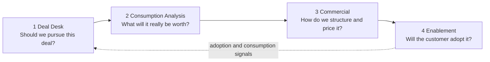

# CRM Deal Desk Agent

**An AI-assisted revenue workflow that helps a cloud sales team decide which deals to pursue, price them with discipline, size what the customer will really consume, and make sure the customer actually adopts what they bought.**

Built for a B2B team selling Azure-aligned data and cloud products. The AI proposes and explains; deterministic engines calculate and enforce; people decide.

---

## The problem

Enterprise cloud deals don't fail in one place. They leak value at every stage: reps qualify from memory, discounts get negotiated without seeing the financial or approval consequences, the signed amount turns out to be unrelated to what the customer will run, and licensed users never get trained so consumption stalls and renewals wobble. Each of those problems lives in a different tool, owned by a different team, and none of them talks to the others. This project connects them into one workflow around a single thing every seller already has: **the deal**.

---

## Four problems, one sales journey



| Stage | The problem a seller or leader feels | What we built | Deep dive |
|---|---|---|---|
| **1. Deal Desk** | Qualification is inconsistent, notes are scattered, optimism goes unchallenged, memos take hours. | A committee of AI agents (data fetch, risk, opportunity, devil's advocate, arbitrator, enablement, memo writer) that scores every deal against **MEDDPICC** and produces an auditable recommendation. | [docs/deal-desk](docs/deal-desk/README.md) |
| **2. Consumption Analysis** | The signed amount says nothing about what the customer will run on Azure, so forecasts and business cases are guesses. | Turns workload requirements into an Azure architecture proposal, resolves pricing, forecasts consumption over 36 months, and evaluates commitment economics and customer ROI. | [docs/consumption-analysis](docs/consumption-analysis/README.md) |
| **3. Commercial** | Negotiation is improvised: discounts, terms and commitments are conceded without seeing NPV impact or who must approve. | Scenario comparison (ask / working / floor), a policy and approval engine, comparable-deal benchmarks, and an AI strategy agent whose proposals are re-validated by the deterministic engines. | [docs/commercial](docs/commercial/README.md) |
| **4. Enablement** | Customers buy licences but few users are trained, so adoption, consumption and renewals are at risk, and nobody sees it until late. | Trigger rules flag skills-gap risk, then a recommendation agent prescribes a course path, personas and a call to action, gated by groundedness and SKU-match checks. | [docs/enablement](docs/enablement/README.md) |

A fifth surface, **GTM Intelligence**, closes the loop: it shows an account's journey over time, records whether a seller accepted, modified or rejected each AI recommendation, and feeds that back as context.

---

## How the pieces connect to sales

The stages are not separate tools; they share data through the deal.

- **Deal Desk → Consumption Analysis.** The qualification evidence (pain, metrics, economic buyer) supplies the inputs for the business case. A deal that is weak on MEDDPICC also produces a low-confidence model, and the model says so.
- **Consumption Analysis → Commercial.** The forecast of what the customer will consume is what makes a commitment level, ramp or discount defensible. Commercial scenarios reuse the same deterministic financial engine, so there is one source of truth for NPV, ROI and payback.
- **Commercial → Enablement.** The commitment you negotiate is a promise to consume. Enablement asks whether the customer has the skills to deliver that consumption.
- **Enablement → Deal Desk.** Adoption risk appears as step 6 of the deal workspace, before the memo is written, and healthy trained customers become the expansion deals the next review wants to see.

Technically this is one join key: `deal_id` links the canonical commercial input, workload profile, architecture, financial output, policy result, recommendation and generated deal package. See [docs/ARCHITECTURE.md](docs/ARCHITECTURE.md).

---

## How this helps an organization

These are the outcomes the design targets. They are goals to measure in your own environment, not results this repository claims.

| For | Intended benefit |
|---|---|
| **Account executives** | Hours of memo, business-case and approval-prep work compressed to minutes, with an honest second opinion before committing. |
| **Sales managers** | One consistent qualification language across reps, so coaching and forecast reviews compare like with like. |
| **Finance and deal desk** | Discount, term and commitment exceptions arrive with their financial impact and approval path attached, instead of being reviewed from scratch. |
| **Customer success and enablement** | Scarce training capacity goes to the accounts where a skills gap threatens renewal or consumption. |
| **Leadership** | Pipeline health, consumption at risk and recommendation quality are visible, and every AI-assisted decision has an audit trail. |

---

## AI principles behind every module

1. **The LLM proposes; deterministic engines decide.** Financial metrics, policy results, approvals and enablement numbers come from code. LLM text is a proposal or interpretation.
2. **Constrained, then verified.** The commercial strategy agent may only choose from a fixed set of actions and structural levers, and every proposal is re-run through the financial and policy engines.
3. **Grounded.** Agents retrieve from operator-owned notes, profiles and knowledge before reasoning; enablement output must pass groundedness and SKU-match gates.
4. **Adversarial by design.** A dedicated devil's advocate stops the system from simply agreeing with the seller.
5. **Human in the loop.** Sellers accept, modify or reject; approvals and feedback are recorded.
6. **Honest about uncertainty.** Inputs carry confidence labels, and scenarios widen when evidence is weak. Gross margin is reported as not modeled rather than invented.
7. **Measured.** Agent output is scored by an LLM judge against a golden dataset and traced with LangSmith.

---

## What is in this repository (and what is not)

This is a **source-and-contract release**: application code, schemas, field definitions, illustrative rules and the five web interfaces. It contains **no datasets or populated records, including synthetic examples**. You supply your own CRM data and inputs, then run the workflows against them. The commercial policies included are illustrative demonstration logic, not any organization's real policy.

Read the design: [Scope and limitations](docs/SCOPE.md) · [Architecture](docs/ARCHITECTURE.md) · [Schemas](docs/SCHEMAS.md) · [Data dictionary](docs/DATA_DICTIONARY.md) · [Business rules](docs/RULES.md) · [Runtime inputs](docs/RUNTIME_INPUTS.md) · [Setup](docs/SETUP.md)

Looking for the original engineering overview, workflow table and publication checks? It now lives in [TECHNICAL_REFERENCE.md](TECHNICAL_REFERENCE.md).

---

## Quick start

Python 3.12 or later.

```bash
python3 -m venv .venv
source .venv/bin/activate
pip install -r requirements.txt -r requirements-dev.txt
cp .env.example .env        # add your own Together API key and Twenty CRM token

python scripts/check_runtime_inputs.py   # see which inputs each workflow needs
python server.py                          # interface at http://localhost:5001
```

The app connects to a separately run Twenty CRM GraphQL service at `http://localhost:3000/graphql`. Details are in [docs/SETUP.md](docs/SETUP.md) and [docs/RUNTIME_INPUTS.md](docs/RUNTIME_INPUTS.md).
