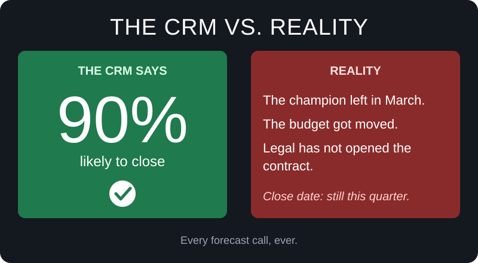
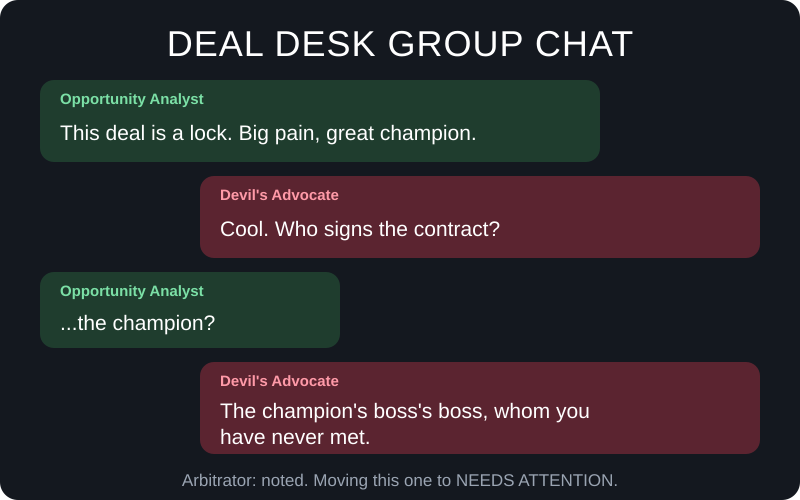
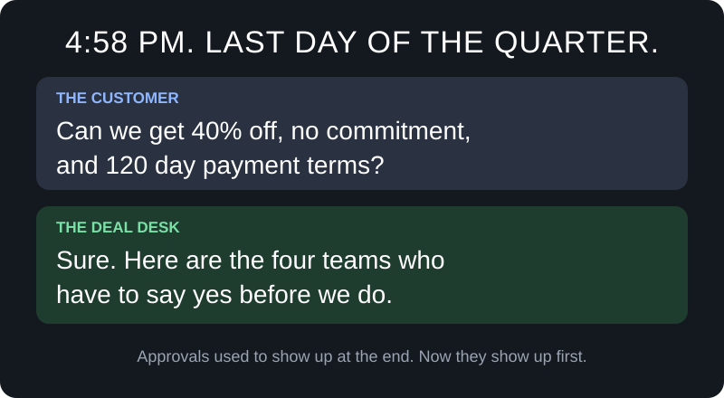
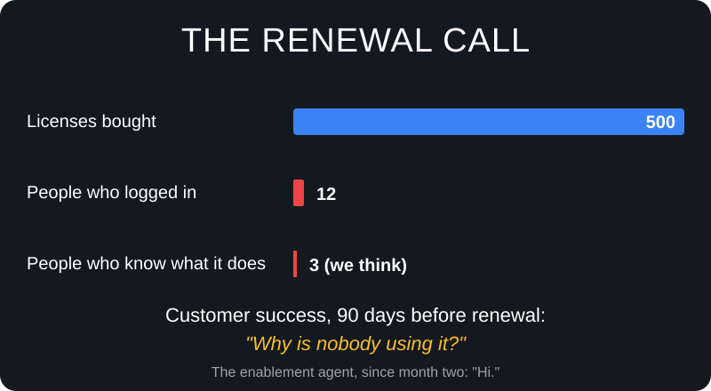

# Sales Agent

*Or: how to stop believing the 90% in the CRM.*

Every sales team has a deal that was "definitely closing this quarter." It's on the forecast. It's in the CRM. It has a green bar next to it. And somewhere around week eleven it quietly stops answering emails.

This project is about that deal, and about the three other things that go wrong before and after it. It's a set of AI helpers for a cloud sales team, built around the one thing every seller already has: the deal.

---

## Meet Sam

Sam is an account executive at Nexus Solutions, a made-up company that sells Azure data and cloud products to large enterprises. Sam and Nexus are fictional. The problems are painfully real.

Sam has a big deal going with Brightwell Bank, which is also made up. On Friday Sam's manager asks how it's looking. Sam says "good, I think," which is the sales version of "the check engine light is probably fine."

Over the next four chapters, Sam's deal runs into everything that can go wrong. Each chapter is one piece of this project.

---

## Chapter 1: The deal that was definitely closing

**The problem.** Sam's qualification lives in Sam's head. The notes are spread across a call recording, two emails and a notebook. The rep down the hall would score the same deal completely differently, because everyone qualifies in their own style. Managers mostly hear the optimistic version. And when a deal needs approval, the memo takes an afternoon to write, which is an afternoon not spent selling.

**What got built: Deal Desk.** Instead of one AI that says yes to everything, there's a small panel, a bit like a deal review meeting where nobody is checking their phone. One member pulls the facts. One worries. One makes the best case for the deal. One is paid to disagree with everybody else. One breaks the tie, and one writes the memo.

Every deal is scored against MEDDPICC, which sounds like a sneeze but is just eight questions any serious deal should be able to answer. What's the measurable win? Who holds the budget? How will they decide? What's the process to get there? What does the paperwork look like? How bad is the pain? Who is our champion inside? Who else are they talking to?

**What changes for Sam.** By Tuesday, Sam learns that the "champion" at Brightwell is also the only person Sam has talked to. Awkward, and very useful. Much better on Tuesday than in week eleven.

---

## Chapter 2: The number that wasn't real

Sam gets a signature. High fives all round. But the number on the contract is what the customer agreed to pay, which is a different thing from what they'll actually run on Azure. If they use half of what they committed to, the next conversation is a sad one, and so is the forecast.

**The problem.** The dollar amount on a contract says very little about what a customer will consume over the next three years. Business cases get built in spreadsheets that were born in 2019 and have seen things.

**What got built: Consumption Analysis.** Describe the customer's workload and the system drafts an Azure setup using only services the company really sells. It prices that setup, projects how usage should grow over three years, and checks whether the commitment on the table makes sense and what return the customer can expect. The AI drafts the architecture. Plain, predictable, boring code does the math. The AI is not allowed anywhere near the calculator.

Every input is labeled as stated by the customer, inferred from the notes, or assumed. So the buyer can see which numbers are facts and which are guesses, and change them.

**What changes for Sam.** The commitment Brightwell is being asked for is now tied to something believable, and Sam can defend it in front of a CFO.

---

## Chapter 3: 4:58 PM on the last day of the quarter

**The problem.** Brightwell wants a huge discount, no commitment and very long payment terms, all in one email. In most companies the reply is to improvise, promise something, and learn on day nine which four teams had to approve it. By then the customer has a competing quote.

**What got built: Commercial.** Sam sees the customer's ask, Sam's current offer and the lowest acceptable floor, side by side. Change a term and the effect on value and payback updates. The rulebook is checked automatically, and Sam is told up front which approvals are needed and in what order.

Similar past deals show up as evidence, never as the rule. There's also an AI strategist that suggests a counter-offer, but every suggestion goes straight back through the same boring checks, so it can't talk itself into a discount nobody is allowed to approve. When the deal is agreed, a deal package gets put together.

**What changes for Sam.** Sam knows who has to say yes before promising anything, and replies to Brightwell the same day.

---

## Chapter 4: The silent churn

**The problem.** Brightwell bought 500 licenses. Twelve people use them. Nobody noticed until the renewal call, because nobody gets an alert titled "this customer is quietly drifting away." Customer success is stretched thin, and training goes out to everyone, which means it helps nobody in particular.

**What got built: Enablement.** It watches for the warning signs. Very few trained users. Learners who stopped showing up. A renewal coming up while skills are low. Big spend on a team that isn't ready for it. When it spots a risk, it recommends which course, for which roles, and what the account team should say, tied to the products that customer actually runs.

The numbers come from code and the wording comes from AI. A quality check blocks any recommendation that isn't grounded in the account's real facts. Sam can accept, edit or reject each suggestion, and that choice is recorded and used as context next time.

**What changes for Sam.** Sam hears about the adoption problem in month two, while it's still fixable, instead of at renewal, when it's a negotiation.

---

## The loop

Customers who are trained use more, renew, and buy more. Those expansions become the next deals. And those deals walk back into Deal Desk looking healthy, which makes the devil's advocate bored.

Deal Desk, then Consumption Analysis, then Commercial, then Enablement, then back to Deal Desk with a happier customer.

Each stage hands its answer to the next one through the deal itself, so nobody has to retype or re-explain anything.

---

## The scoreboard

A story is nice. A scoreboard is how you find out whether it worked. These are the numbers this project is meant to move.

| KPI | The question behind it | Where this project helps |
|---|---|---|
| Win rate on qualified deals | Are we spending time on deals that can actually close? | Deal Desk asks every rep the same eight questions and argues against optimism. |
| Forecast accuracy | Does what we say will close actually close? | Deal Desk risk scores, and consumption projections that reflect reality. |
| Sales cycle length | How long from first meeting to signature? | Memos, business cases and counter-offers drop from days to minutes. |
| Seller prep time | How many hours go into memos, spreadsheets and approval packets? | All four stages take work off the seller's plate. |
| Discount leakage | How far do final discounts drift from what policy allows? | Commercial shows the cost of every concession before it's made. |
| Approval turnaround | How many rounds before we get a yes? | Commercial lists the needed approvals and their order on day one. |
| Commitment attainment | Do customers consume what they committed to? | Consumption Analysis ties the commitment to a believable forecast. |
| Trained-user coverage | What share of licensed users know how to use the product? | Enablement flags the gaps and says who should learn what. |
| Renewal and expansion | Do customers stay, and do they grow? | Enablement, plus the loop back into Deal Desk. |
| Trust in the AI | How often do sellers accept, edit or reject suggestions? | Every response is recorded. A healthy mix beats a 100% accept rate. |

**How to use it.** Write down last quarter's numbers first. Run this on a slice of your pipeline for one quarter. Compare. This repository doesn't claim any results of its own. It gives you the machinery and the scoreboard.

---

## What this is, and what it isn't

- The AI recommends and people decide. Nothing gets sent, signed or approved on its own.
- The AI writes the words and the math is done by code, on purpose, so the numbers can always be traced.
- This repository includes no data at all. No accounts, no deals, no customers, not even fake ones. You bring your own CRM and your own inputs.
- The example policies in the repo are demonstration rules, not any real company's policy.
- Sam, Nexus Solutions and Brightwell Bank are made up. Any resemblance to your last quarter is a coincidence.

---

## Want to look under the hood?

Each chapter has its own deeper write-up, in the same story-first style.

- [Deal Desk](docs/deal-desk/README.md)
- [Consumption Analysis](docs/consumption-analysis/README.md)
- [Commercial](docs/commercial/README.md)
- [Enablement](docs/enablement/README.md)

For the engineering side, see the [architecture](docs/ARCHITECTURE.md), the [scope and limitations](docs/SCOPE.md), the [setup guide](docs/SETUP.md) and the [original technical overview](TECHNICAL_REFERENCE.md).
