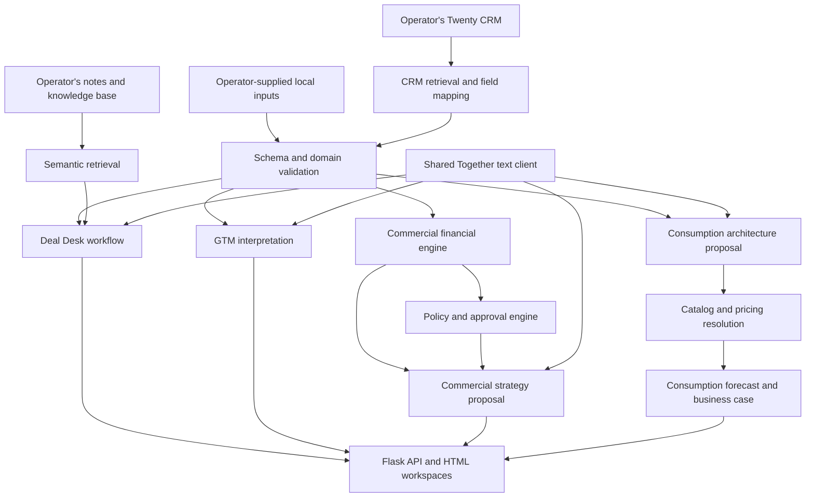

# Architecture

## Components

- `server.py` serves the interfaces, provides Flask endpoints, streams progress, and manages runtime metrics and approval state.
- `deal_desk.py` composes the analysis and memo-writing stages.
- `tools/llm_client.py` loads the environment configuration and adapts streamed model responses into text, structured output, and tool calls.
- `knowledge_base/knowledge_lookup.py` retrieves operator-owned knowledge from a locally built vector store.
- `tools/commercial_financial_analysis.py` and `tools/commercial_policy_engine.py` calculate and validate commercial scenarios.
- `tools/commercial_strategy_agent.py` proposes negotiation structures and sends them back through deterministic validation.
- `tools/consumption_architecture_planner.py` plans workload architecture and checks supported catalog choices.
- Pricing, forecast, business-case, enablement, and reporting modules derive their outputs from operator-supplied inputs.

## Relationships

`deal_id` joins the canonical commercial input, workload profile, architecture, financial output, policy result, recommendation, and generated package. `account_id` or account slug joins account-level context. Company/deal slugs locate local notes. `service_id` joins architecture service rows to resolved prices. `catalog_id`, when present, identifies a supported catalog choice.

Text inference can send the input context for the selected workflow to the configured provider. Optional tracing and email delivery are separate integrations configured by the operator. The publication itself contains neither the input context nor credentials.

Runtime JSON outputs, SQLite databases, downloaded reports, vector indexes, and caches are created locally when the operator runs the corresponding actions. They are outside the publication allowlist.
