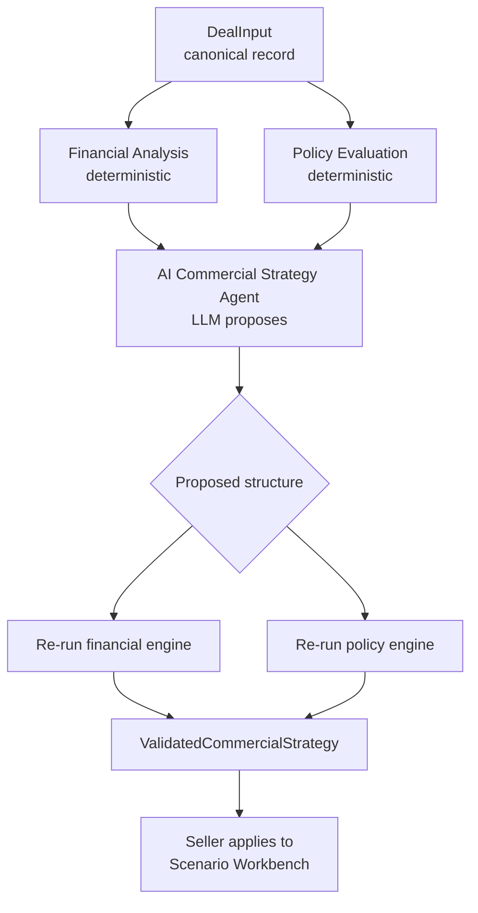

# Commercial Strategy — Negotiate with a guardrail, not a hunch

> **One line:** Give a seller a working scenario they can reshape, let an AI propose the best structure, then have deterministic engines prove what it costs and who has to approve it — before anything goes to the customer.

**Part of the Nexus Solutions GTM suite:** [Deal Desk](../deal-desk/README.md) → [Consumption Analysis](../consumption-analysis/README.md) → **Commercial** → [Enablement](../enablement/README.md) · [Back to main README](../../README.md)

---

## 1. The business problem

Once a customer says "we like it, but...", the deal enters negotiation. That is where margin leaks and cycle time balloons.

| Who feels it | What hurts today |
|---|---|
| **AE** | The customer asks for a bigger discount, longer payment terms, a smaller commitment. The AE improvises, then discovers late which approvals are needed. |
| **Finance / Legal / Sales leadership** | Exceptions arrive unstructured, without the financial impact, so each one is reviewed from scratch. |
| **Deal Manager** | Everything is a trade-off (give / get), but nobody can see the trade-off side by side. |
| **The customer** | Waits days for answers that should take hours. |

**The core insight:** negotiation isn't "approve or reject." It's a search for a structure both sides can live with. The seller needs to *see the consequences of each move instantly* and know early which moves trigger which approvals.

---

## 2. Who we designed for (Empathize)

- **The AE / Deal Manager** negotiating live, who needs to answer "what if we gave X in exchange for Y?" in the room.
- **Approvers** (Finance, Legal, Sales Leadership, Business Planning, Product, Commercial Deal Making) who want exceptions to arrive complete and ordered.
- **Leadership** who want guardrails enforced consistently, not by whoever is most persuasive.

Jobs to be done:

1. *"Show me the customer's ask next to what I can actually offer, and the floor."*
2. *"Tell me what this concession does to NPV, ROI and payback."*
3. *"Tell me who I'll need approval from, in what order — now, not at the end."*
4. *"Suggest a counter-offer, but don't let it break policy."*

---

## 3. How we solve it

### 3.1 Design principle: separate "thinking" from "proving"

The central design decision in this module: **the LLM is allowed to propose, never to decide the numbers.**



### 3.2 We built it in phases, each one a trust layer

| Phase | What we built | Why it came in this order |
|---|---|---|
| **1. Data** | Canonical `DealInput` schema, field mapping from CRM, 37 canonical records (36 active + 1 golden deal), customer asks, seller offers, guardrails, approval matrix, 50 historical precedents. | You can't automate negotiation without a clean, shared definition of "a deal." |
| **2. Financial adapter** | Translates `DealInput` into the existing financial model. Supports scenario overrides (discount, term, commitment, billing, credits, list value) and compares *customer ask / recommended test / commercial floor*. Reports commitment coverage, shortfall, overage. | Reuses the one financial engine from [Consumption Analysis](../consumption-analysis/README.md) so there is a single source of truth. |
| **3. UI** | `commercial_analysis.html`: pick a deal, compare scenarios, edit the working scenario, inspect economics, guardrails, notes and calculation trace. | Sellers must *see* the trade-offs before trusting any AI on top. |
| **4. Policy engine** | Rule-driven evaluation across Pricing, Deal Size, Contract Term, Payment Terms, Consumption Commitment, Financial Return and Legal Terms. Consolidates duplicate approvers, orders them deterministically, returns remediation and a trace. **No LLM.** | Approvals must be predictable and explainable. |
| **5. AI strategy agent** | LLM recommends one of `ACCEPT / COUNTER / RESTRUCTURE / ESCALATE / DECLINE` and a structure limited to discount, term, commitment, billing frequency and payment terms. | Added last, once there was a deterministic safety net to validate it. |

### 3.3 The seller's workflow

1. **Select a deal.** Pick an active negotiation (defaults to the golden deal `GOLDEN-DEAL-1001` for demos).
2. **See the gap.** Customer ask vs. working scenario vs. commercial floor, side by side, with commercial health.
3. **Reshape.** Edit the working scenario; everything recalculates through the backend (the browser calculates nothing).
4. **Check policy.** See `REQUIRES_APPROVAL` or not, which approver groups, in what order, and how to remediate.
5. **Ask for a strategy (optional).** Click **Analyze Deal**. The AI proposes a structure; the engines validate it.
6. **Apply.** The validated structure is copied into the workbench and re-run through the same APIs.

On the golden deal the three scenarios illustrate why this matters: the **customer ask** needs 4 approver groups, the **working scenario** needs 2, and the **commercial floor test** needs 3. The seller sees the approval cost of each concession *before* making it.

### 3.4 The negotiation problems we deliberately covered

The synthetic data spans seven distinct commercial situations, so the tooling is tested against variety, not a single happy path: discount negotiation, commitment/ramp negotiation, payment-term negotiation, credits vs. recurring discount, strategic multi-product expansion, complex multi-exception deals, and restructure-or-reject.

---

## 4. AI principles we applied

| Principle | How it shows up here |
|---|---|
| **Constrained action space** | The LLM may only pick five verbs and five structural levers. Unsupported fields are rejected before validation. |
| **Propose, then verify** | Every AI proposal is re-run through the deterministic financial and policy engines. The numbers and approvals shown always come from them. |
| **Configuration over code for policy** | Rules live in `commercial_policy_rules.json` and `commercial_approval_hierarchy.json`, so policy can change without a redeploy. |
| **Explainability** | Both engines return a **trace** showing inputs, rules fired and source configuration. |
| **Don't fabricate** | Gross margin is returned as `NOT_MODELED` / `null` rather than invented. No margin approval check is faked. |
| **Cost-aware AI** | The agent is called only when the seller clicks **Analyze Deal**, and results are cached by grounded context, engine outputs and scenario assumptions. |
| **Human in the loop** | The seller chooses whether to apply a recommendation. Nothing is sent or signed automatically. |

---

## 5. How we'll know it's working (proposed success metrics)

Baselines must come from real usage; this repo contains demonstration data.

| Outcome | Metric | Direction |
|---|---|---|
| Speed | Time from customer ask to validated counter-offer | ↓ |
| Discipline | % of deals whose approvals were identified *before* submission | ↑ |
| Margin protection | Average discount vs. guardrail on closed deals | ↓ toward guardrail |
| Efficiency | Approval rounds per deal | ↓ |
| Trust | Recommendation accept / modify / reject mix | Healthy mix |

---

## 6. Honest limitations

- **Everything here is synthetic.** Asks, offers, guardrails, approval thresholds and historical precedents are demonstration data. They are **not Microsoft internal policy**, not real Microsoft deal data, and not legal or pricing advice.
- Gross margin is **not modeled**.
- The strategy agent **does not yet use historical comparable deals or RAG**, even though the 50 precedents and normalized comparables are already prepared for it.
- This module does not yet include a deal builder or contract/agreement generation.

### Roadmap, in the order the data foundations make possible

1. Comparable-deal retrieval (RAG) over the 50 precedents, so recommendations cite "deals like this."
2. Approval routing and submission.
3. Deal builder and agreement generation.
4. A gross margin model, so the one `NOT_MODELED` category can be switched on.

---

## 7. Run it

```bash
python generate_commercial_negotiation_data.py   # deterministic synthetic data
python server.py
# open http://localhost:5001/commercial-analysis
```

| Key route | Purpose |
|---|---|
| `GET /api/commercial-analysis/{deal_id}` | Deal input + financial analysis |
| `POST .../scenario` | Recalculate one scenario |
| `GET/POST .../policy` · `POST .../policy/compare` | Policy evaluation and scenario comparison |
| `POST .../strategy` | AI strategy, validated by the engines |
| `POST .../strategy/validate` | Validate a structure without calling the LLM |

**Key files:** [`tools/commercial_data.py`](../../tools/commercial_data.py) · [`tools/commercial_financial_analysis.py`](../../tools/commercial_financial_analysis.py) · [`tools/commercial_policy_engine.py`](../../tools/commercial_policy_engine.py) · [`tools/commercial_strategy_agent.py`](../../tools/commercial_strategy_agent.py) · [`commercial_analysis.html`](../../commercial_analysis.html) · [`knowledge_base/commercial_strategy/`](../../knowledge_base/commercial_strategy/)

**Next in the journey →** once the deal is signed, the goal is that customers actually use what they bought: [Enablement](../enablement/README.md).
