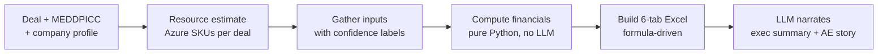

# Consumption Analysis — Turning a deal amount into a business case the customer believes

> **One line:** For any deal, estimate what the customer will actually run on Azure, what it costs, what it saves, and when it pays back — in a live Excel model where every number can be traced and overridden.

**Part of the Nexus Solutions GTM suite:** [Deal Desk](../deal-desk/README.md) → **Consumption Analysis** → [Commercial](../commercial/README.md) → [Enablement](../enablement/README.md) · [Back to main README](../../README.md)

---

## 1. The business problem

In a consumption business, the **signed amount is not the value**. Revenue and customer outcomes both depend on what the customer *actually runs* on Azure over the following years — and whether the savings they were promised show up.

| Who feels it | What hurts today |
|---|---|
| **AE** | Pitches a number but can't show the customer a credible ROI. Business cases are hand-built spreadsheets that take days and silently break. |
| **Customer's economic buyer (CFO / IT leader)** | Hears "trust us" instead of seeing assumptions they can challenge. |
| **Deal desk / finance** | Can't tell whether a deal's headline price is supported by realistic consumption and payback. |
| **Leadership** | Overstated ROI today becomes a missed consumption forecast and a frustrated customer tomorrow. |

**The core insight:** a business case is only persuasive if the buyer can *change an assumption and watch the answer move*. A static PDF can't do that. A formula-driven workbook can.

---

## 2. Who we designed for (Empathize)

- **The AE** who needs a credible, deal-specific story fast.
- **The customer's economic buyer**, a sceptic who will poke at the assumptions — so the model must be transparent enough to survive that.
- **The reviewer** who needs to see which numbers are *stated by the customer* versus *assumed by us*.

Jobs to be done:

1. *"Give me an ROI I can defend in front of a CFO."*
2. *"Show me which numbers are real and which are guesses."*
3. *"Let me change the discount or growth rate and see what happens."*
4. *"Don't let me oversell — I'll be held to this."*

---

## 3. How we solve it

### 3.1 The workflow



| Stage | What happens | Where |
|---|---|---|
| **Estimate** | An LLM estimates the infrastructure (Azure SKUs) a deal would need. Runs in batch across all 380 deals, largest first, safe to resume. | [`generate_resource_estimates.py`](../../generate_resource_estimates.py) |
| **Gather** | Pulls financial signals from MEDDPICC and company profiles. Every input is tagged `STATED / INFERRED / ASSUMED / UNKNOWN`. When confidence is low, an LLM extracts more from the deal notes. | [`tools/financial_inputs.py`](../../tools/financial_inputs.py) |
| **Compute** | Deterministic maths: costs, savings, payback, ROI, NPV. **No LLM, no Excel.** | [`tools/financial_model.py`](../../tools/financial_model.py) |
| **Build** | Writes a 6-tab workbook where every metric is an Excel formula tied back to one Assumptions tab. | [`tools/excel_builder.py`](../../tools/excel_builder.py) |
| **Narrate** | An LLM writes the executive summary and the AE's commercial story *around* numbers it cannot change. | `tools/financial_model_runner.py` |

### 3.2 The workbook, one tab per question the buyer asks

| Tab | Buyer's question | What it answers |
|---|---|---|
| **1. Summary** | "What's the headline?" | Annual cost of the problem, Year 1 investment, payback, 3-year net, confidence score, data provenance. All links, no hardcodes. |
| **2. Assumptions** | "What are you assuming?" | Every editable input in one place. **Blue** = stated/inferred, can override. **Yellow** = benchmark assumption, flagged for review. |
| **3. 3-Year Model** | "Where does the money go and come back?" | Costs (implementation + Azure consumption), savings, net, cumulative, NPV at 10%. |
| **4. Scenarios** | "What if you're wrong?" | Conservative / Base / Optimistic, each column independent. |
| **5. Azure Estimate** | "What will I actually run?" | SKU-level monthly cost that **always ties to the consumption assumption** (variance = $0). Service mix varies by Quick Start / Production Grade / Enterprise Scale. |
| **6. Commercial** | "How do I buy it?" | Month-to-month vs 1-year vs 3-year, and Azure EA tier analysis (how close am I to the next discount tier). |

### 3.3 Where it connects to the rest of the suite

- **Deal Desk** supplies the MEDDPICC evidence and profile the inputs are extracted from.
- **Commercial** reuses this exact financial engine to test discount, term and commitment scenarios (so there is one source of truth for NPV, ROI and payback).
- **Enablement** uses the same consumption estimates to show how much consumption is *at risk* when users aren't trained.

---

## 4. AI principles we applied

| Principle | How it shows up here |
|---|---|
| **Deterministic where it matters** | Money maths lives in plain Python and Excel formulas. The LLM never computes ROI. |
| **Honesty about uncertainty** | Every input carries a confidence label. Confidence drives the scenario band: **HIGH** 70%–120%, **MEDIUM** 50%–130%, **LOW** 30%–150%. Low-confidence deals get wider bands, not false precision. |
| **Transparent, overridable assumptions** | One Assumptions tab is the single source of truth; no tab references another tab's inputs; no circular references. |
| **LLM as narrator, not calculator** | The LLM writes the story *around* the figures, never the figures. |
| **Conservative by construction** | Rules that prevent overselling (below). |

### Rules that keep the model honest

1. **No double counting.** Time savings are zeroed when a stated pain figure exists, because time is already a component of that pain.
2. **No impossible capture.** Pain reduction ramps 70% in Year 1 to 95% in Year 2, and Year 3 grows the *captured* amount, so it can never exceed 100% of the pain.
3. **Total cost in the denominator.** ROI divides by all 3-year costs (implementation + consumption), not implementation alone.
4. **Payback uses Year 1 total cost** against monthly savings net of recurring consumption.

### What the bugs taught us

The README's bug log is a product lesson, not just a changelog. Several fixes were about the model being *too optimistic*: ROI was overstated roughly 6× by dividing by implementation cost alone, and ~$442K/yr was double-counted on one deal (payback moved from 3.3 to 6.2 months once fixed). A business case that overstates is worse than none, because the AE gets held to it. Fixing these made the model credible rather than just impressive.

---

## 5. How we'll know it's working (proposed success metrics)

Baselines need to come from real usage — the figures in this repo come from demonstration data.

| Outcome | Metric | Direction |
|---|---|---|
| Speed | Time to produce a deal-specific business case | Days → minutes |
| Credibility | % of workbook inputs labelled `STATED` or `INFERRED` vs `ASSUMED` | ↑ |
| Accuracy | Forecast Year 1 consumption vs. actual consumption | Gap ↓ |
| Adoption | % of PROPOSAL-stage deals with a model attached | ↑ |
| Customer engagement | Assumptions edited by the buyer in review sessions | ↑ (a sign they trust it enough to test it) |

---

## 6. Honest limitations

- Resource estimates are **LLM-generated** from deal context; they are a starting point to validate with a solution architect, not a quote.
- Unit rates use **Azure list pricing (eastus)**. Real EA/contract rates differ and should be overridden in the Assumptions tab.
- Year 1 consumption is a rule of thumb (`deal amount × 0.60`), then grown by an assumed rate.
- The model does **not** compute gross margin or gross profit.
- Deal data is synthetic.

---

## 7. Run it

```bash
# One deal (partial name match works)
python tools/financial_model_runner.py --deal "SecurityO — Multi-Year License"

# Three test deals across HIGH / LOW / AT RISK confidence
python tools/financial_model_runner.py --test

# Full batch: estimate resources, then generate all workbooks
python generate_resource_estimates.py
python financial_model_generator.py
```

Output: `knowledge_base/financial_models/{company}_{deal}.xlsx`. Restart `server.py` after changing `excel_builder.py`.

**Next in the journey →** once we know what the deal is worth, we decide how to structure and negotiate it: [Commercial](../commercial/README.md).
