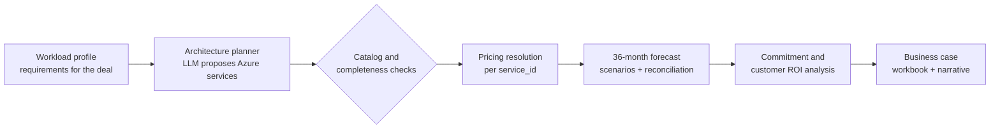

# Consumption Analysis — Turning a deal amount into a business case the customer believes

> **One line:** For any deal, plan what the customer will actually run on Azure, price it, forecast it over 36 months, and test the commitment and ROI — with an AI that proposes the architecture and deterministic engines that do the maths.

**Part of the Nexus Solutions GTM suite:** [Deal Desk](../deal-desk/README.md) → **Consumption Analysis** → [Commercial](../commercial/README.md) → [Enablement](../enablement/README.md) · [Back to main README](../../README.md)

---

## 1. The business problem

In a consumption business, the **signed amount is not the value**. Revenue and customer outcomes both depend on what the customer *actually runs* on Azure over the following years, and whether the savings they were promised show up.

| Who feels it | What hurts today |
|---|---|
| **AE** | Pitches a number but can't show the customer a credible architecture, cost or ROI. Business cases are hand-built spreadsheets that take days and silently break. |
| **Customer's economic buyer (CFO / IT leader)** | Hears "trust us" instead of seeing assumptions they can challenge. |
| **Deal desk / finance** | Can't tell whether a headline price or commitment is supported by realistic consumption. |
| **Leadership** | A consumption forecast built on an overstated deal becomes a missed number and a frustrated customer. |

**The core insight:** a commitment is only defensible if it is anchored to a believable picture of what the customer will run, what it costs, and how that grows. Every one of those steps must be visible and overridable.

---

## 2. Who we designed for (Empathize)

- **The AE** who needs a credible, deal-specific story fast.
- **The customer's economic buyer**, a sceptic who will poke at the assumptions.
- **The solution architect / reviewer** who needs to see which choices are supported by the service catalog and which numbers are stated versus assumed.

Jobs to be done:

1. *"Show me an architecture I can put in front of the customer, using services we actually sell."*
2. *"Tell me what it costs per month and how that grows over three years."*
3. *"Tell me what commitment and ROI that supports."*
4. *"Show me which numbers are real and which are guesses, and let me change them."*

---

## 3. How we solve it

### 3.1 The workflow



| Stage | What happens | Where |
|---|---|---|
| **Profile** | Workload requirements for the deal are captured as a profile the rest of the flow reads. | [`tools/enterprise_workload_profiler.py`](../../tools/enterprise_workload_profiler.py) · [`tools/consumption_profiles.py`](../../tools/consumption_profiles.py) |
| **Plan** | An LLM proposes an Azure architecture. The proposal is parsed, normalized and **validated**: catalog-conformance violations are flagged and completeness is scored. | [`tools/consumption_architecture_planner.py`](../../tools/consumption_architecture_planner.py) |
| **Price** | Each architecture service row is joined by `service_id` to a resolved Azure retail price. You refresh pricing in your own environment. | [`tools/azure_retail_pricing.py`](../../tools/azure_retail_pricing.py) · [`scripts/refresh_azure_eastus_pricing.py`](../../scripts/refresh_azure_eastus_pricing.py) |
| **Forecast** | A 36-month, service-level consumption forecast with scenarios, growth assumptions, scaling modes and a reconciliation check. Deterministic. | [`tools/consumption_forecast.py`](../../tools/consumption_forecast.py) |
| **Commit and ROI** | Evaluates commitment economics and customer ROI from validated business-case assumptions with confidence levels. | [`tools/consumption_commercial_intelligence.py`](../../tools/consumption_commercial_intelligence.py) |
| **Business case** | A formula-driven Excel workbook and narrative for the customer conversation (below). | [`tools/financial_model.py`](../../tools/financial_model.py) · [`tools/excel_builder.py`](../../tools/excel_builder.py) · [`tools/financial_inputs.py`](../../tools/financial_inputs.py) |

The interface is [`consumption_analysis.html`](../../consumption_analysis.html), served by `server.py`.

### 3.2 The business-case workbook, one tab per question the buyer asks

| Tab | Buyer's question | What it answers |
|---|---|---|
| **1. Summary** | "What's the headline?" | Cost of the problem, Year 1 investment, payback, 3-year net, confidence, data provenance. |
| **2. Assumptions** | "What are you assuming?" | Every editable input in one place, colour-coded by data confidence. |
| **3. 3-Year Model** | "Where does the money go and come back?" | Costs, savings, net, cumulative, NPV. |
| **4. Scenarios** | "What if you're wrong?" | Conservative / Base / Optimistic, each column independent. |
| **5. Azure Estimate** | "What will I actually run?" | SKU-level monthly cost tied back to the consumption assumption. |
| **6. Commercial** | "How do I buy it?" | Commitment options and Azure EA tier analysis. |

### 3.3 Where it connects to the rest of the suite

- **Deal Desk** supplies the qualification evidence the inputs are extracted from, and its confidence is carried into the model.
- **Commercial** reuses the same deterministic financial engine to test discount, term and commitment scenarios, so there is one source of truth for NPV, ROI and payback.
- **Enablement** uses consumption figures to show how much consumption is at risk when users aren't trained.
- A shared `deal_id` joins the workload profile, architecture, forecast and financial output to the rest of the deal record (see [docs/ARCHITECTURE.md](../ARCHITECTURE.md)).

---

## 4. AI principles we applied

| Principle | How it shows up here |
|---|---|
| **LLM proposes, code decides** | The LLM drafts the architecture and narrative. Pricing, forecast, commitment economics, ROI and payback are deterministic. |
| **Validate before trusting** | Architecture proposals are checked against the supported catalog and for completeness before they reach pricing. |
| **Reconcile** | The forecast includes a reconciliation check, so totals can't drift from their inputs. |
| **Honesty about uncertainty** | Inputs carry confidence labels (`STATED / INFERRED / ASSUMED / UNKNOWN`) and scenario bands widen when confidence is low. |
| **Transparent, overridable assumptions** | One Assumptions tab is the single source of truth for the workbook. |
| **Conservative by construction** | Time savings are not added on top of a stated pain figure (no double counting); captured pain cannot exceed 100%; ROI divides by total three-year cost, not implementation alone. |

---

## 5. How we'll know it's working (proposed success metrics)

Baselines need to come from your own usage; this repository ships no data.

| Outcome | Metric | Direction |
|---|---|---|
| Speed | Time from deal to a priced architecture and business case | Days → minutes |
| Credibility | % of inputs labelled `STATED` or `INFERRED` vs `ASSUMED` | ↑ |
| Accuracy | Forecast consumption vs. actual consumption | Gap ↓ |
| Catalog fit | % of proposed architectures passing catalog checks first time | ↑ |
| Adoption | % of PROPOSAL-stage deals with a consumption analysis attached | ↑ |

---

## 6. Honest limitations

- Architecture proposals are **LLM-generated**; treat them as a starting point to validate with a solution architect.
- Pricing depends on the catalog and price snapshot **you** supply. List prices differ from negotiated EA or contract rates and should be overridden where they do.
- The model does **not** compute gross margin or gross profit.
- Forecasts are scenario projections, not predictions. Calibrate growth assumptions to your customers.
- This repository ships no workload, catalog, pricing or deal data. See [docs/SCOPE.md](../SCOPE.md) and [docs/RUNTIME_INPUTS.md](../RUNTIME_INPUTS.md).

---

## 7. Run it

```bash
python scripts/check_runtime_inputs.py   # see which catalog, pricing and workload inputs are needed
python server.py                          # then open the Consumption Analysis interface
```

To produce a workbook for one deal from the command line:

```bash
python tools/financial_model_runner.py --deal "<deal name>"
```

**Next in the journey →** once we know what the deal is worth, we decide how to structure and negotiate it: [Commercial](../commercial/README.md).
