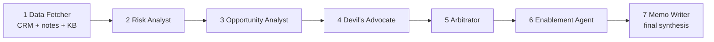
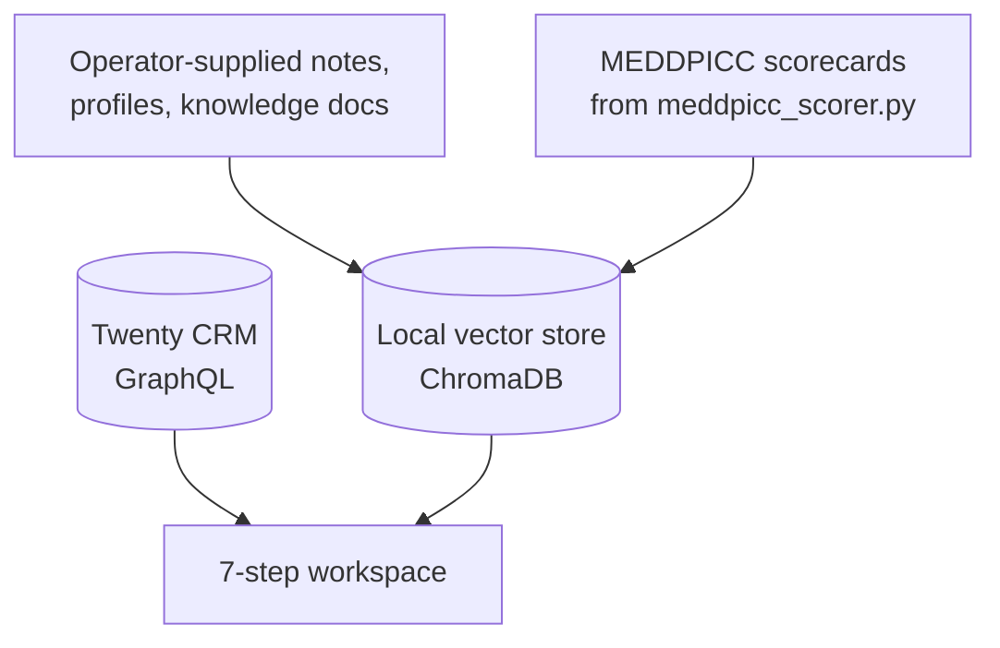

# Deal Desk — From "gut feel" to a defensible go / no-go

> **One line:** An AI committee that reads everything we know about a deal, argues with itself, and hands a seller and a manager one auditable recommendation — in minutes, not days.

**Part of the Nexus Solutions GTM suite:** **Deal Desk** → [Consumption Analysis](../consumption-analysis/README.md) → [Commercial](../commercial/README.md) → [Enablement](../enablement/README.md) · [Back to main README](../../README.md)

---

## 1. The business problem

Nexus Solutions sells Azure-aligned data and cloud infrastructure products to enterprise buyers. Deals sit in the CRM at stages like `NEW → MEETING → PROPOSAL → CUSTOMER`, but the CRM stage says almost nothing about whether a deal will actually close.

| Who feels it | What hurts today |
|---|---|
| **Account Executive (AE)** | Qualification is done from memory. Notes are scattered across calls and docs. Writing a deal memo is hours of manual work. |
| **Sales manager / deal desk reviewer** | Reviews are inconsistent. Every rep defines "qualified" differently. Optimism bias goes unchallenged. |
| **Sales leadership** | Forecast quality depends on who is talking. There is no audit trail for why a deal was approved or pushed back. |

**The core insight:** the problem isn't a lack of data. It's that nobody has time to *read* all of it and *argue with it* before a deal moves forward.

---

## 2. Who we designed for (Empathize)

- **Primary user — the AE** who needs a fast, honest second opinion before committing to a proposal.
- **Secondary user — the deal desk reviewer / manager** who needs a consistent, comparable view across deals and reps.
- **Stakeholder — leadership** who needs pipeline health they can trust and decisions they can audit.

What they told us they need (framed as the "jobs to be done"):

1. *"Tell me where this deal is actually weak — before the customer does."*
2. *"Challenge my story. Don't just agree with me."*
3. *"Give me something I can paste into an approval request."*
4. *"Show me which of my deals need me this week."*

---

## 3. How we solve it

### 3.1 Define: a shared language for deal quality (MEDDPICC)

Rather than invent a score, we adopted the sales qualification framework teams already know — **MEDDPICC**: Metrics, Economic Buyer, Decision Criteria, Decision Process, Paper Process, Identify Pain, Champion, Competition.

Every deal is scored on all eight elements as `confirmed / partial / at_risk / unknown`, and rolled up to **STRONG / NEEDS ATTENTION / AT RISK**. Same rubric for every rep, every deal.

### 3.2 Ideate → Prototype: a committee of specialists, not one big prompt

A single LLM prompt tends to be agreeable. We split the job into roles that mirror a real deal review, including one whose job is to disagree.



| Step | Role | Why it exists |
|---|---|---|
| 1 | **Data Fetcher** | Pulls the deal from Twenty CRM and retrieves relevant notes, company profile, battlecards and similar-deal history from the knowledge base. Grounds everything that follows. |
| 2 | **Risk Analyst** | Finds what could kill the deal, citing evidence. |
| 3 | **Opportunity Analyst** | Makes the best honest case *for* the deal. |
| 4 | **Devil's Advocate** | Attacks both views. Counters optimism bias and groupthink. |
| 5 | **Arbitrator** | Weighs the arguments and issues a clear recommendation. |
| 6 | **Enablement Agent** | Adds post-sale adoption risk, because a deal that closes but isn't adopted is a future churn. See [Enablement](../enablement/README.md). |
| 7 | **Memo Writer** | Final synthesis into a deal memo that can be saved back to the CRM. |

**Design choice worth calling out:** Enablement sits *before* the Memo Writer, so the memo is the last step and reflects the full picture, rather than enablement being an afterthought bolted on after the decision.

### 3.3 The knowledge the agents reason over



The four ChromaDB collections (`deal_notes`, `kb_documents`, `company_profiles`, `meddpicc_scores`) are kept separate on purpose so each agent retrieves targeted context instead of noise. You supply the notes and knowledge content; this repository ships none.

### 3.4 Where the seller and manager actually work

| Surface | What it gives them |
|---|---|
| `index.html` — Deal workspace | Pick a deal, watch the agents stream their reasoning live, query the knowledge base, save the memo, download a `.docx`. |
| `dashboard.html` — Pipeline Intelligence | **Overall health** (donut, risk flags, product at-risk rate, proposal-stage deals with AT RISK first, top-5 next priorities), **Rep portfolio** (deal table with expandable MEDDPICC chips and a coaching card), **Leadership** (DuPont ROI chain, CAC, LTV, funnel, what-if sensitivity). |

---

## 4. AI principles we applied

| Principle | How it shows up here |
|---|---|
| **Adversarial by design** | A dedicated Devil's Advocate role so the system doesn't just validate the seller. |
| **Grounded, not guessing** | Agents retrieve from deal notes, profiles and the KB before reasoning. |
| **Show the work** | Output streams to the browser step by step; each agent's reasoning is visible. |
| **Human stays in the loop** | The system recommends. Memos are saved and approvals are recorded by a person. |
| **Auditability** | Approval decisions are written to `approval_audit.db`; run latency, tokens and agent timings to `metrics.db`. |
| **Measured quality** | Every agent is scored by an LLM judge against a golden dataset (see below). |
| **Observable** | LangSmith tracing on every LLM call. |

### How we know it works: the eval system

A golden dataset (`deal-desk-golden-v1`: 2 CRM deals per stage, with stage-specific rubrics) is scored by an LLM judge on four criteria per agent, each `0 / 2.5 / 5`. Each agent maxes at 20 with a pass at ≥ 10; the pipeline is scored on coherence, contradiction detection, data thread and memo quality. **Final score is 0–100; pass at ≥ 70.** Results appear in the **Evals** tab and as a LangSmith experiment.

Failures taught us things too — e.g. the judge model returning integer `2` instead of `2.5` zeroed every score until we added value-snapping. Evals found it; that's what they're for.

---

## 5. How we'll know it's working (proposed success metrics)

These are the outcomes this module is meant to move. Baselines need to be captured from your own usage; this repository ships no data.

| Outcome | Metric | Direction |
|---|---|---|
| Speed | Time from "deal selected" to "memo ready" | ↓ |
| Consistency | % of deals with all 8 MEDDPICC elements assessed | ↑ |
| Forecast quality | Win rate of deals scored STRONG vs. AT RISK | Wide, stable gap |
| Trust | % of recommendations accepted vs. modified vs. rejected | Healthy mix (not 100% accepted) |
| AI quality | Eval pass rate, hallucination-check scores | ↑ |

---

## 6. Honest limitations

- This repository is a **source-and-contract release with no data**. You supply your own CRM records, notes and knowledge content; see [Scope](../SCOPE.md).
- MEDDPICC scores are **LLM-judged from notes**, so they are only as good as the notes. They are a prioritisation aid, not ground truth.
- The recommendation is advisory. Approval remains a human decision.

---

## 7. Run it

```bash
python scripts/check_runtime_inputs.py   # which inputs the workflows need
python server.py                          # then open http://localhost:5001
```

Full setup: [docs/SETUP.md](../SETUP.md) and [docs/RUNTIME_INPUTS.md](../RUNTIME_INPUTS.md).

Or from the terminal for one deal: `python run.py` (interactive) · `python run_pipeline_batch.py` (all open deals).

**Key files:** [`deal_desk.py`](../../deal_desk.py) · [`server.py`](../../server.py) · [`meddpicc_scorer.py`](../../meddpicc_scorer.py) · [`index.html`](../../index.html) · [`dashboard.html`](../../dashboard.html) · [`tools/eval_judge.py`](../../tools/eval_judge.py)

**Next in the journey →** once a deal is worth pursuing, we quantify its value: [Consumption Analysis](../consumption-analysis/README.md).
