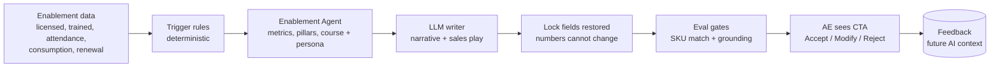

# Customer Enablement — Make sure the customer actually uses what they bought

> **One line:** Detect accounts where low training is quietly putting renewal and consumption at risk, and give the account team a specific, grounded, measurable next step — not a generic "send them to training."

**Part of the Nexus Solutions GTM suite:** [Deal Desk](../deal-desk/README.md) → [Consumption Analysis](../consumption-analysis/README.md) → [Commercial](../commercial/README.md) → **Enablement** · [Back to main README](../../README.md)

---

## 1. The business problem

A signed deal is not a successful customer. In a consumption model, revenue only arrives if people actually use the product, and people only use what they know how to use.

| Who feels it | What hurts today |
|---|---|
| **Account team (AE / CSM)** | Learns an account is at risk when the customer is already unhappy or silent. Training offers are generic and unmeasured. |
| **Customer's champion** | Bought the product, but most licensed users have never been trained. Adoption stalls and the champion's credibility erodes. |
| **Enablement team** | Can't target scarce capacity at the accounts where training changes the outcome. |
| **Leadership** | Renewal and consumption forecasts hide a skills gap that shows up too late. |

**The core insight:** skills gaps are a *leading indicator* of churn and under-consumption. They can be detected from data we already have, early enough to act.

---

## 2. Who we designed for (Empathize)

- **The AE / CSM** who needs "what should I do on this account this week?" in one screen.
- **The enablement owner** who needs to know which learners (by role) need which course, and whether it moved anything.
- **The sales manager** who needs coaching prompts for reviewing the account with the rep.
- **Partners**, where the customer relationship is partner-managed and the motion must adapt.

Jobs to be done:

1. *"Tell me which accounts have a skills problem before the renewal conversation."*
2. *"Tell me which course, for which persona, and why."*
3. *"Give me a call-to-action I can send today."*
4. *"Show me whether training actually lifted consumption."*

---

## 3. How we solve it

### 3.1 The workflow: detect → diagnose → prescribe → measure



### 3.2 Detect: four triggers, each tied to a business risk

| Trigger | Logic | The business risk it flags |
|---|---|---|
| `LOW_TRAINED_COVERAGE` | trained / licensed users < 25% | Shelfware, churn risk |
| `STALLED_ADOPTION` | attendance < 50% **and** inactive > 30 days | Onboarding friction, stalled learning |
| `RENEWAL_RISK` | renewal in < 90 days **and** coverage < 40% | Skills gap becomes a renewal blocker |
| `HIGH_CONS_LOW_TRAIN` | Azure consumption > $50K **and** skills-gap risk > 70 | High spend on a fragile operating model; support-escalation risk |

The rules are intentionally simple and legible, so an AE can understand *why* an account was flagged.

### 3.3 Prescribe: a structured recommendation, not a paragraph

For each account the agent returns a structured payload the AE can act on:

- **Recommended course path** from Azure-aligned tracks (Data Platform Fundamentals, Cost Optimization, Security & Governance, AI and ML Operations, Integration Architecture, Analytics Engineering, Reliability and Observability), matched to the SKUs the customer runs.
- **Target personas** from the learner roster (e.g. "Fraud Operations Lead").
- **Business metrics, impact pillars and predictive signals** with evidence.
- **Manager coaching toolkit** with behaviors to inspect and questions to ask.
- **Success measures** with current value, target, owner and time horizon (e.g. coverage 22.9% → 70%+ in 30–45 days).
- **Free-to-paid opportunity** with a motion type and pitch narrative, so enablement also links to expansion.
- **A single CTA** (e.g. "Schedule a 30-min Skills Assessment...") and a partner-adaptation note.

### 3.4 Measure: closing the loop

- The **Enablement view** of the dashboard shows portfolio trained-user coverage, critical-risk accounts, average coverage gap, estimated consumption at risk, renewal-risk accounts, skills-gap risk by SKU, and a **training-to-consumption lift** scatter.
- Every recommendation can be marked **Accept CTA / Modify / Reject**; these are logged to `approval_audit.db` and become context for future recommendations.
- Recommendations can be saved as a `.docx` **Enablement Impact Report** with real Word tables.

### 3.5 Where it sits in the Deal Desk

In the 7-step deal workspace, the Enablement Agent is **step 6, before the Memo Writer**. Adoption risk is part of the go-forward recommendation, so the final memo synthesizes it rather than ignoring it. See [Deal Desk](../deal-desk/README.md).

---

## 4. AI principles we applied

| Principle | How it shows up here |
|---|---|
| **Numbers are never the LLM's job** | Metrics, trigger flags, tables, course and persona selection are computed in code. The LLM writes only the summary, narrative, coaching wording and sales play. |
| **Lock, then restore** | After the LLM responds, the server **restores the locked fields**, so the model cannot alter a number, metric name, trigger or course choice. |
| **Graceful degradation** | If the LLM fails, deterministic fallback text is used and the AE still gets a usable recommendation. |
| **Quality gates before the user sees it** | Each recommendation is scored for **groundedness**, **specificity** and **actionability**. Hard gates: the **SKU Match Gate** rejects courses that don't match the customer's resources; the **Grounding Gate** rejects groundedness below 0.85. |
| **Observable** | Eval rows go to `metrics.db`; with a LangSmith key, every eval is pushed as a run with feedback scores. |
| **Human decides** | The AE accepts, modifies or rejects the CTA, and that choice feeds future recommendations. |
| **Explicit data contract** | `enablement_schema.py` validates ranges and roster shape, applies tier defaults (Enterprise / Mid-Market / SMB) and records warnings instead of failing silently. |

---

## 5. How we'll know it's working (proposed success metrics)

The data in this repo is synthetic, so these are the outcomes to measure once real data is connected.

| Outcome | Metric | Direction |
|---|---|---|
| Coverage | Trained / licensed users on flagged accounts | ↑ toward 70%+ |
| Consumption | Consumption change on accounts after training vs. a comparable untrained group | ↑ |
| Retention | Renewal rate of `RENEWAL_RISK` accounts that received the motion | ↑ |
| Field adoption | % of CTAs accepted or modified (vs. ignored/rejected) | ↑ |
| Quality | Recommendation pass rate through both gates | ↑ |
| Efficiency | Time for an AE to go from alert to sent CTA | ↓ |

Field-adoption, rollout and governance plans are documented in [`knowledge_base/field_adoption_plan.md`](../../knowledge_base/field_adoption_plan.md); architecture and roadmap in [`product_roadmap_architecture.md`](../../knowledge_base/product_roadmap_architecture.md); retrieval design in [`retrieval_knowledge_base_design.md`](../../knowledge_base/retrieval_knowledge_base_design.md).

---

## 6. Honest limitations

- All 380 account records, learner rosters and users counts are **generated deterministically for demonstration**. Real CRM and LMS integration is the next step.
- Trigger thresholds (25%, 50%, 90 days, $50K, 70) are sensible starting points that should be tuned against real churn data.
- "Training-to-consumption lift" shows correlation, not causation. A controlled comparison is needed before claiming impact.

---

## 7. Run it

```bash
python generate_enablement_data.py     # builds knowledge_base/enablement_data.json
python server.py

curl -X POST http://localhost:5001/api/enablement/recommend \
  -H "Content-Type: application/json" \
  -d '{"company_slug":"alpine_financial_services","deal_slug":"datafabric_proof_of_concept"}'
```

| Route | Purpose |
|---|---|
| `GET /api/dashboard/enablement` | Portfolio rollup and AE action feed |
| `POST /api/enablement/recommend` | One structured recommendation; also accepts `ACCEPT_CTA` / `MODIFY` / `REJECT` feedback |
| `POST /api/enablement/report` | Download the `.docx` Enablement Impact Report |

**Key files:** [`enablement_agent.py`](../../enablement_agent.py) · [`tools/enablement_rules.py`](../../tools/enablement_rules.py) · [`tools/enablement_eval.py`](../../tools/enablement_eval.py) · [`generate_enablement_data.py`](../../generate_enablement_data.py) · [`knowledge_base/schemas/enablement_schema.py`](../../knowledge_base/schemas/enablement_schema.py)

**Back to the start →** [Deal Desk](../deal-desk/README.md). The loop closes: healthy, trained customers become the strong, expandable deals the Deal Desk wants to see next.
