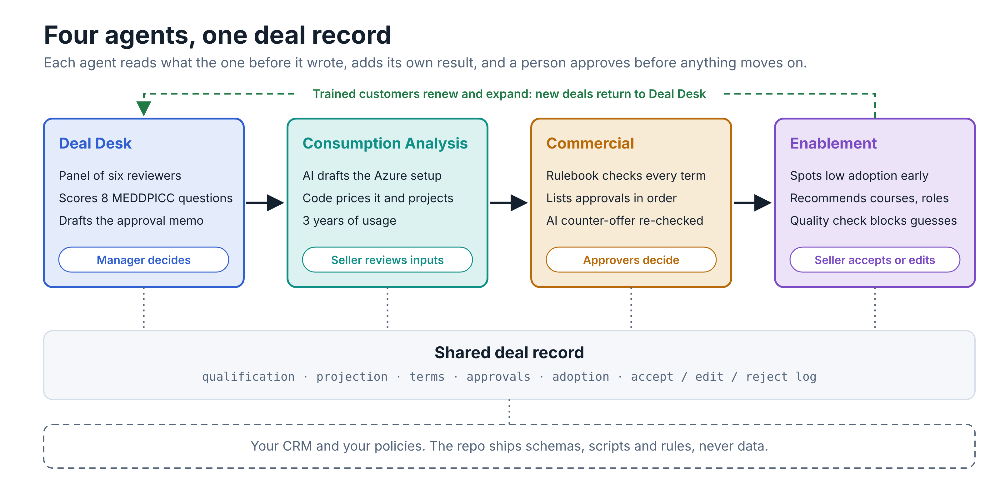
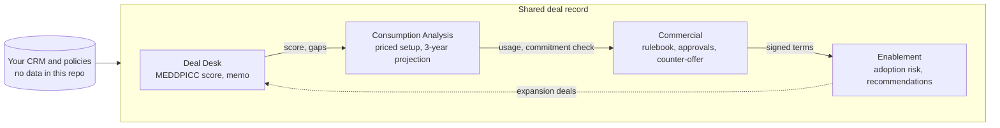
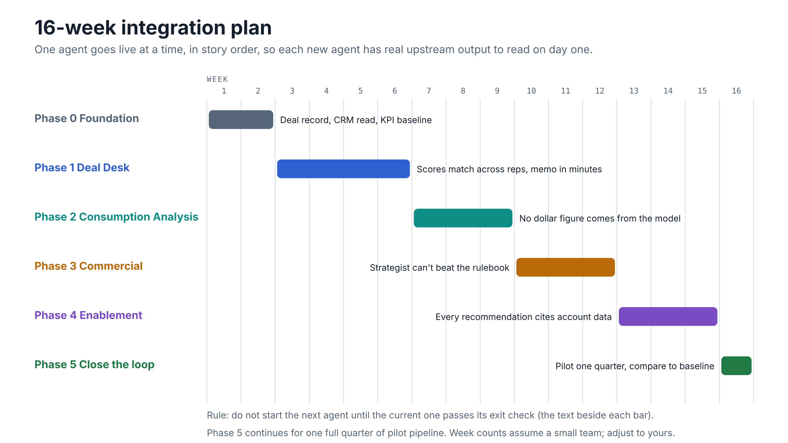
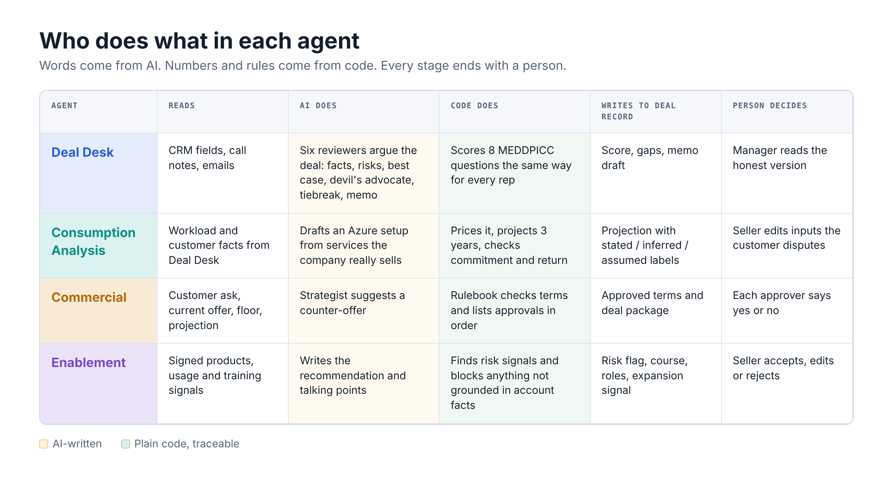

# Integration roadmap

How the four agents (Deal Desk, Consumption Analysis, Commercial and Enablement) get wired into one loop. Each agent reads what the one before it wrote to the deal record and adds its own result, so nothing is retyped. People approve at every stage.

Week counts are a planning assumption for a small team. Field names in the handoff table are placeholders until they are mapped to the repo's schemas.

## How the agents connect

## Timeline

| Phase | Agent | Weeks |
| --- | --- | --- |
| 0 | Foundation: shared deal record, guardrails, KPI baseline | 1-2 |
| 1 | Deal Desk | 3-6 |
| 2 | Consumption Analysis | 7-9 |
| 3 | Commercial | 10-12 |
| 4 | Enablement | 13-15 |
| 5 | Close the loop, then one quarter of pilot pipeline | 16 onward |

Do not start the next agent until the current one passes its exit check.

## Phase 0: Foundation (weeks 1-2)

- Deal record schema built from the repo's field definitions.
- Read connection to your CRM. The repo stores no data.
- One accept / edit / reject log shared by all four agents.
- Your own policy and rule files loaded in place of the demonstration ones.
- Model access, secrets handling and run logging.
- Last quarter's baseline written down for every KPI on the scoreboard.

**Exit check:** one test deal can be created, read and updated by a script, and all ten baseline KPIs are recorded.

## Phase 1: Deal Desk (weeks 3-6)

- Panel of six: fact puller, worrier, advocate, devil's advocate, tiebreaker and memo writer.
- Pulls call notes, emails and CRM fields into one fact set.
- Writes to the deal record: eight MEDDPICC scores with evidence, gaps (for example a champion who is the only contact) and an approval memo draft.

**Exit check:** two reps scoring the same deal land within one point on each MEDDPICC question, and a memo takes minutes instead of an afternoon.

## Phase 2: Consumption Analysis (weeks 7-9)

- Reads workload and customer facts from the Deal Desk output.
- The architecture agent is limited to services the company actually sells.
- Deterministic code prices the setup, projects three years of growth and checks the commitment and customer return.
- Every input is tagged stated, inferred or assumed.

**Exit check:** no dollar figure comes from the model. Each number traces to a code path and an input label.

## Phase 3: Commercial (weeks 10-12)

- Shows the customer ask, current offer and floor side by side.
- The Phase 2 projection sets value and payback for each term change.
- Rulebook check returns the approvals needed and their order.
- Similar past deals appear as evidence only.
- The strategist's counter-offers go back through the same rulebook. A deal package is assembled on agreement.

**Exit check:** the strategist cannot produce an offer the rulebook rejects, and the seller sees the required approvals before replying.

## Phase 4: Enablement (weeks 13-15)

- Products and commitment from the deal record define what to monitor.
- Watches usage and training signals: few trained users, learners who stopped, renewal close with low skills, large spend on an unready team.
- Recommends courses, roles and talking points tied to the products the customer runs.
- A quality check blocks recommendations not grounded in account facts.

**Exit check:** every recommendation cites account data, and seller choices are logged and fed back as context.

## Phase 5: Close the loop (week 16 and one quarter)

- Expansion signals from Enablement open a new deal that enters Deal Desk with prior results attached.
- Run a slice of pipeline for one quarter and compare against the Phase 0 baseline.
- Review the accept / edit / reject mix for each agent.

**Exit check:** a written readout per KPI and a decision on which agents to widen to the full pipeline.

## Who does what

## Handoffs

| Handoff | What passes | Why the next agent needs it |
| --- | --- | --- |
| CRM to Deal Desk | Account, stage, contacts, notes, emails, call transcript | Builds the shared fact set the panel argues over. |
| Deal Desk to Consumption | Workload, pain, budget holder, decision process, score gaps | Sizes the architecture and flags assumptions to confirm. |
| Consumption to Commercial | Three-year projection, commitment check, customer return, input labels | Ties every discount and term change to value and payback. |
| Commercial to Enablement | Signed products, commitment, renewal date, deal package | Defines which products and roles to monitor. |
| Enablement to Deal Desk | Adoption health, expansion signal, seller feedback log | Opens the next deal already informed by real usage. |

## Rules at every connection

- People decide. Nothing is sent, signed or approved automatically.
- Code does the math. Pricing, projections, payback and policy checks are plain code.
- Every number is traceable through its stated, inferred or assumed label.
- AI output (strategist text, recommendations) is re-checked by the rulebook and grounding checks.
- No data lives in the repo. Connectors read from your systems at run time.
- Every response is logged, so accept, edit and reject counts show how much sellers trust each agent.

## KPI checks by stage

| After | First KPIs to watch |
| --- | --- |
| Phase 1 | Seller prep time, win rate on qualified deals, forecast accuracy |
| Phase 2 | Commitment attainment, forecast accuracy, sales cycle length |
| Phase 3 | Discount leakage, approval turnaround, sales cycle length |
| Phase 4 | Trained-user coverage, renewal and expansion |
| Phase 5 | All ten KPIs against baseline, plus trust in the AI |

This repository makes no result claims of its own. Targets come from your baseline.
